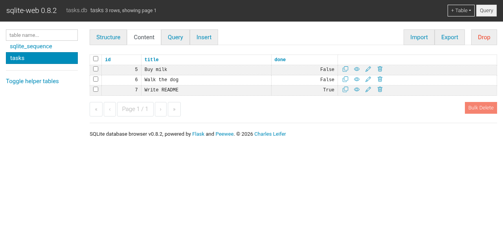

# Task API — SQLite edition (Assignment 2)

The Assignment 1 Task API, with the in-memory list replaced by a real
**SQLite** database. The endpoints and JSON responses are unchanged, but tasks
now survive a server restart.

## Why SQLite?

- Zero setup: it ships with Python (`sqlite3`), so there is no database server to install.
- The whole database is a single file, which is easy to inspect, copy and delete.
- Plenty for a small single-process API like this one.

## Where the database is stored

`tasks.db`, next to `main.py` (created automatically on first start, git-ignored).
Delete the file to start fresh; it is recreated with three seed tasks.

## How to start

```bash
python -m venv .venv && source .venv/bin/activate
pip install -r requirements.txt
uvicorn main:app --reload
```

Open http://127.0.0.1:8000/docs for Swagger. On first start the `tasks` table
is created and seeded if it is empty; nothing else to set up.

Run the tests (they use a temporary database, never `tasks.db`):

```bash
pytest
```

## Endpoints

| Method | Path | Notes |
| --- | --- | --- |
| GET | `/` , `/health` | info / health check |
| GET | `/tasks` | `?done=true|false`, `?search=milk` (SQL `LIKE`) |
| GET | `/tasks/{id}` | 404 if unknown |
| POST | `/tasks` | 201; 400 on blank title |
| PUT | `/tasks/{id}` | 400 on empty body, 404 if unknown |
| DELETE | `/tasks/{id}` | 204 |
| GET | `/stats` | `COUNT`/`SUM` computed in SQL |
| POST | `/reset` | restores the seed data |

All queries are parameterized (no string-built SQL). Errors keep the A1 shape: `{"error": "..."}`.

## Database viewer

I used [sqlite-web](https://github.com/coleifer/sqlite-web) (`pip install sqlite-web`, then `sqlite_web tasks.db`).



## Example SQL I ran

```sql
SELECT * FROM tasks WHERE done = 1;
```

The full session (list, filter, count, `UPDATE`, `DELETE`, and the API reflecting
each change immediately) is in [`docs/sql-session.txt`](docs/sql-session.txt).
